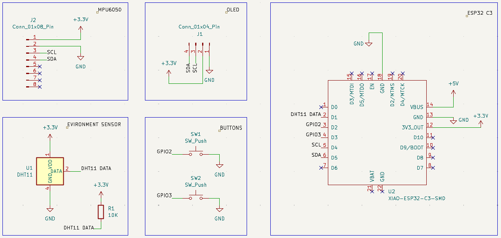
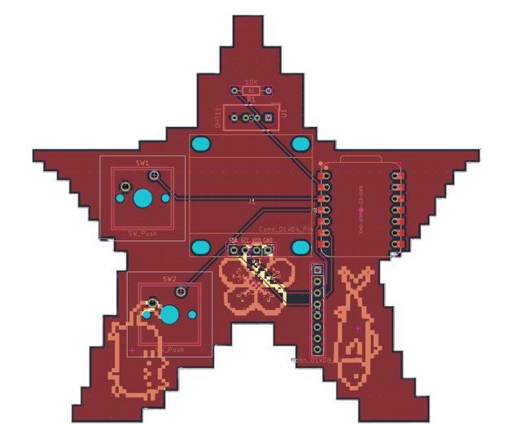
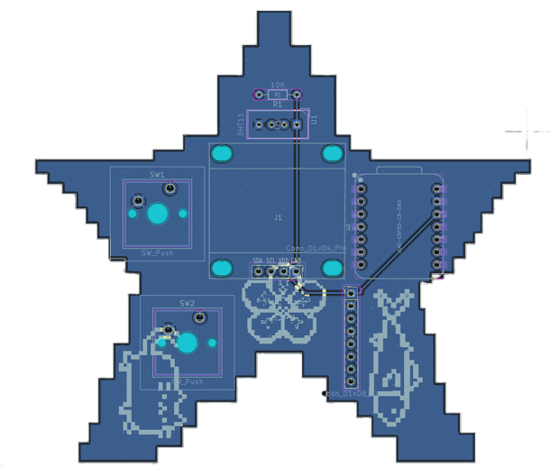

# My first PCB
Creating a desktop Tamagotchi, the starbie

I am building a tiny desktop Tamagotchi that reacts to motion by using [this guide](https://github.com/SharKingStudios/Starbie/blob/main/Week%201%20Guide.md).
I am a beginner in hardware projects, therefore I am using this guide to learn and expand my knowledge in the world of electronics. 

I would recommend such guides to people who are just starting out. As a beginner myself I have already learned various skills and I am just getting started. 

## Progress

🚧This project is still a work in progress🚧

## Completed

  ### Schematic
  

  ### Front routing

  

  ### Back routing

  
    
   
    
### Next steps ...

  - assemble it
  - customization 

## Process

This is my first hardware project and I am pretty excited about it! 

As I mentioned before, I followed a [guide](https://github.com/SharKingStudios/Starbie/blob/main/Week%201%20Guide.md) for this project. 
I kept practically all of the guides structure for my guide too because I do not feel comfortable experimenting yet. 

I only changed two things:

  - The board drawings

    Not everything has to follow the guide exactly. Choosing your own drawings makes the project feel more personal. 

  - The Tamagotchi pet
    
      I felt that this was necessary because every project is unique and should a touch of your own ideas and personality.
    
    
## Bill of Materials (BOM)

| Item | Qty | Supplier | Cost/item | Total Cost | Link |
|---|---:|---|---:|---:|---|
| XIAO ESP32C3 | 1 | AliExpress | $8.15 | $8.15 | [Link](https://de.aliexpress.com/item/1005013002900559.html?spm=a2g0o.cart.0.0.32264ae4ClPc9i&mp=1&pdp_npi=6%40dis!CHF!CHF+6.89!CHF+6.89!!CHF+6.89!!!%400b88a95617917462954892625e0e87!12000059971037083!ct!CH!-1!!1!0!&gatewayAdapt=glo2deu) |
| MPU6050 | 1 | AliExpress | $1.10 | $1.10 ||
| PCB | 1 | JLCPCB | $23.61 | $23.61 | [Link](https://jlcpcb.com/) |
| DHT11 | 1 | AliExpress | (already have but costs around ~$1.60) | $0.00 | [Link](https://de.aliexpress.com/item/1005008953430940.html?spm=a2g0o.productlist.main.10.29e171f3eZmP9T&algo_pvid=9a4fa176-278c-4808-82e2-d20ae622629e&algo_exp_id=9a4fa176-278c-4808-82e2-d20ae622629e-9&pdp_ext_f=%7B%22order%22%3A%22257%22%2C%22spu_best_type%22%3A%22price%22%2C%22eval%22%3A%221%22%2C%22fromPage%22%3A%22search%22%7D&pdp_npi=6%40dis%21USD%211.56%211.09%21%21%2110.38%217.26%21%400b88abba17930501085407364e0f7a%2112000047346503744%21sea%21CH%218519706619%21ABX%211%210%21n_tag%3A-29910%3Bd%3A44f8d9c9%3Bm03_new_user%3A-29895%3BpisId%3A5000000219526372&curPageLogUid=OnmqP8GDwoyb&utparam-url=scene%3Asearch%7Cquery_from%3A%7Cx_object_id%3A1005008953430940%7C_p_origin_prod%3A) |
| OLED screen (0.96 inches) | 1 | AliExpress | (already have but costs around ~$1.30) | $0.00 ||
| Estimated total shipping | 1 | - | - | $0.00 | - |

### Total Cost : ~ $32.86

