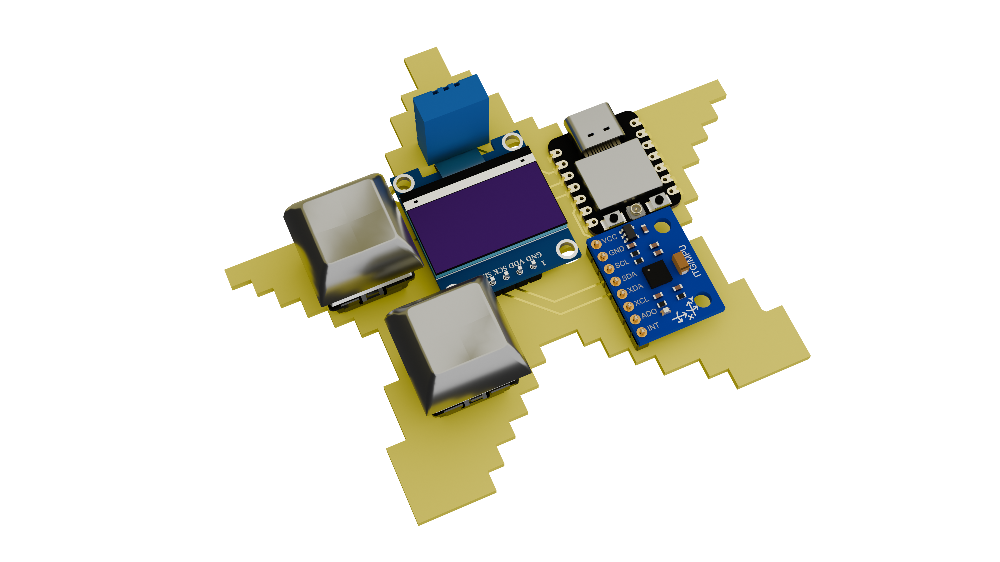

# My first PCB
Creating a desktop Tamagotchi, the starbie

# Project 

I am building a tiny desktop Tamagotchi that reacts to motion by using [this guide](https://github.com/SharKingStudios/Starbie/blob/main/Week%201%20Guide.md).
I am a beginner in hardware projects, therefore I am using this guide to learn and expand my knowledge in the world of electronics. 

I would recommend such guides to people who are just starting out. As a beginner myself I have already learned various skills and I am just getting started. 

## Progress

🚧This project is still a work in progress🚧

### Currently working on ...

  - the firmware
    
### Next steps ...

  - finish programming
  - update BOM.md and JOURNAL.md
    

